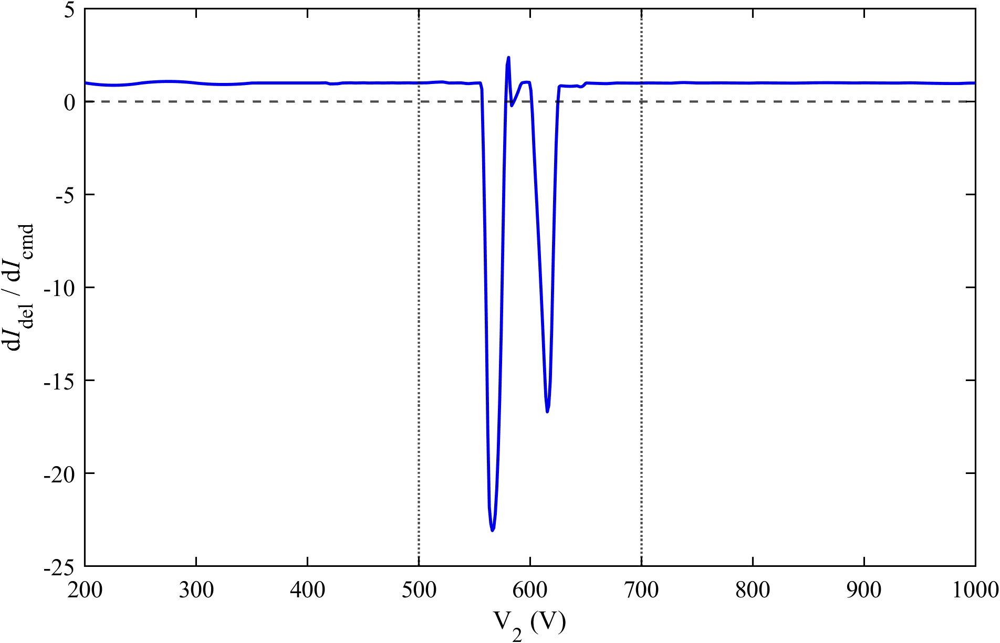
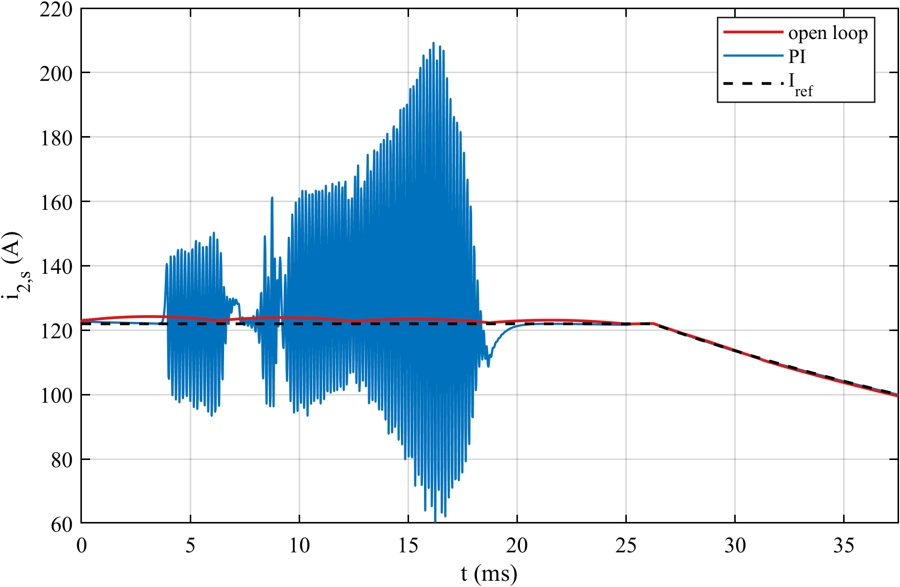
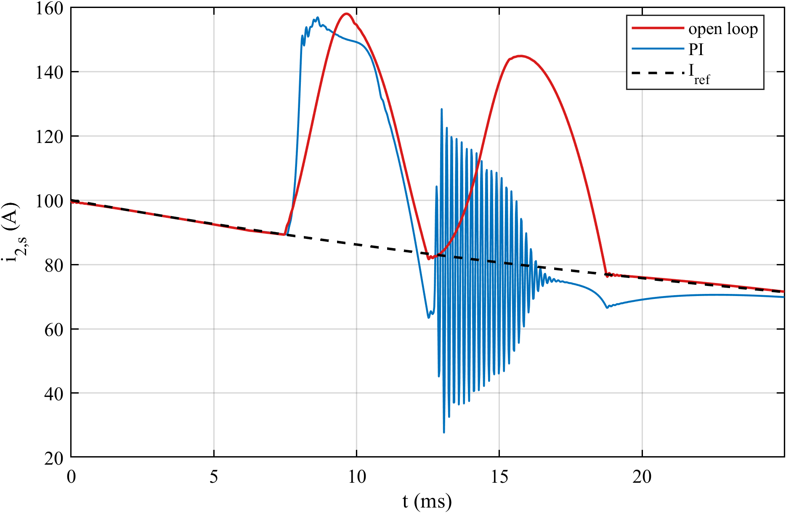
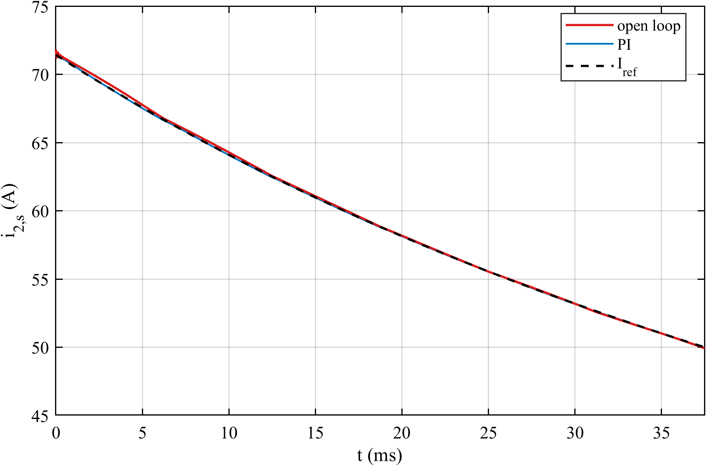
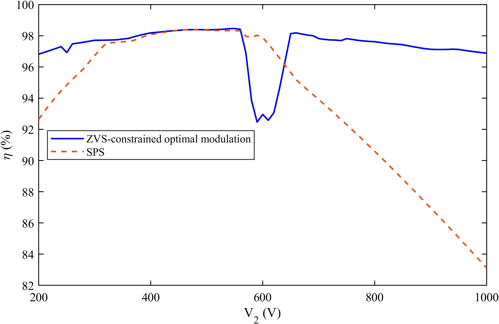
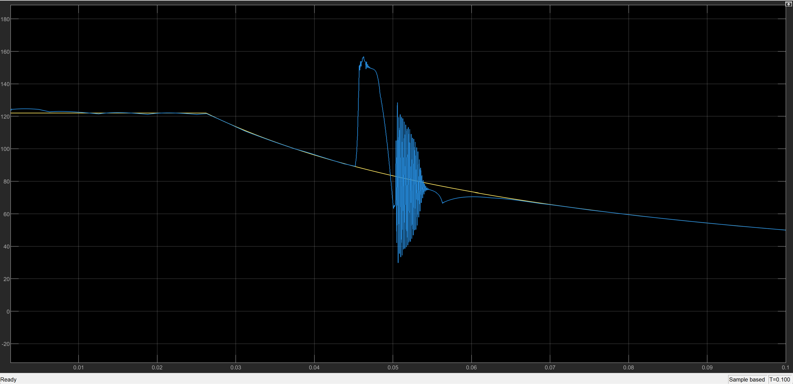
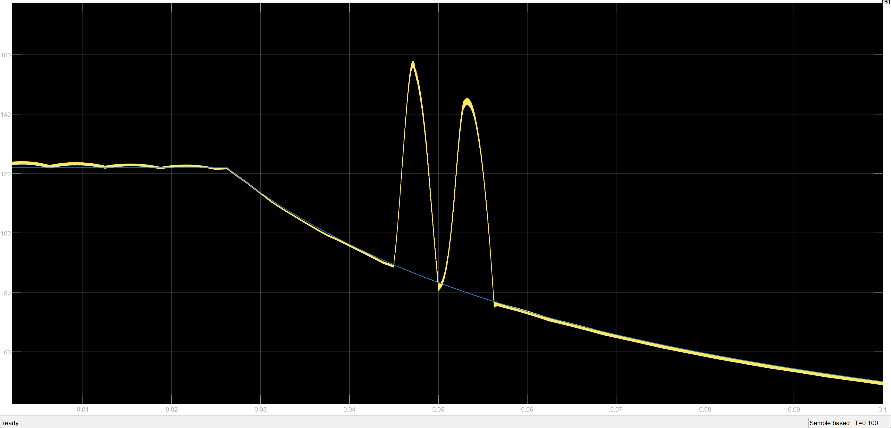

# Deployability of a ZVS-Constrained Optimal Modulation LUT for PI Current Control of a Wide-Voltage-Range DAB

Optimal triple-phase-shift (TPS) modulation of a dual active bridge (DAB) is usually computed offline, stored in a look-up table (LUT) and interpolated between its stored points. This project asks whether a plain PI current controller can run such a LUT along a 200–1000 V battery-charging profile. The LUT keeps zero-voltage switching (ZVS) on all eight commutations and, among those duty triplets, uses the one with the lowest RMS current.

## Contributions

1. **Command-to-current gain of an optimal-modulation LUT.** An ideal inverse modulation delivers exactly the commanded current, so its gain from command to delivered current is unity. A stored, bilinearly interpolated LUT does not. The controller samples the current once per switching period, so the gain it actually sees is the sampled gain g_s, evaluated on the exact five-state model of the converter. The gain decomposition shows that g_s can leave unity only in LUT cells that span a jump of the modulation between operating modes.

2. **g_s as a deployability metric for a fixed PI controller.** An interpolation error is only a bias, which the integral action removes. A negative g_s inverts the sign of the feedback, and the controller then amplifies the error. The widest reversal along the charging ramp limits the usable crossover frequency, and the spread of g_s sets the margins the PI is tuned for. With one PI tuned per voltage range, the metric shows that the ZVS-constrained LUT is controllable at light and heavy load and not at medium load.

## Converter

| Parameter | Value |
|---|---|
| Input voltage V_i | 800 V |
| Output voltage V_2 | 200–1000 V |
| Turns ratio n | 1.7 |
| AC-link inductance L_s / resistance R_s | 15 µH / 25 mΩ |
| Input filter L_i / R_i / C_i | 10 µH / 0.1 Ω / 30 µF |
| Output filter L_o / R_o / C_o | 10 µH / 0.1 Ω / 44 µF |
| Switching frequency f_s | 50 kHz |
| Switches | Wolfspeed CAB320M17XM3 SiC module |
| Charging profile | I_ref = min(122 A, 50 kW / V_2), ramp 8 V/ms |

## Modulation LUT

The LUT has 40 current × 17 voltage operating points, 5–122.5 A and 200–1000 V in 50 V steps. At each point, D1 and D2 are scanned on a 70 × 70 grid and every D3 that delivers the commanded current is solved for. Among the triplets with ZVS on all eight commutations, the one with the lowest RMS current is stored.

## Sampled gain along the charging profile

The gain stays close to unity at light and heavy load. At medium load, between 500 and 700 V, it reverses in three stretches, down to about −23. The widest reversal is 25.4 V, which the ramp crosses in 3.2 ms, so the crossover frequency of a PI controller in that range is limited to 50 Hz.

## PI controller per voltage range

Each range gets its own PI controller, tuned only on the gain inside that range. The plant is scaled to the median positive g_s of the range. The controller is accepted when the loop scaled to the 10th and 90th percentiles of g_s keeps PM ≥ 45° and GM ≥ 6 dB, and when its crossover respects the reversal limit.

| Range | Load | g_s median | g_s p10 / p90 | Reversals | f_c | Kp | Ki | PM min | GM min | Ramp worst error | Verdict |
|---|---|---|---|---|---|---|---|---|---|---|---|
| 200–500 V | light | 1.000 | 0.988 / 1.026 | 0 | 300 Hz | 0.01882 | 1882.2 | 86.1° | 18.5 dB | – | controllable |
| 500–700 V | medium | 0.997 | 0.972 / 1.014 | 3 | 50 Hz | 0.00315 | 315.0 | 89.4° | 34.0 dB | 69.0 A | PI fails |
| 700–1000 V | heavy | 0.998 | 0.961 / 1.013 | 0 | 300 Hz | 0.01887 | 1887.1 | 86.2° | 18.7 dB | 0.40 A | controllable |

The margins are met in every range. At medium load the PI controller still fails: on the ramp, the correction saturates at ±20 A in 163 of 1250 switching periods and the tracking error reaches 69.0 A.

## Efficiency against SPS

The losses are estimated from the CAB320M17XM3 datasheet at T_vj = 125 °C. Conduction losses use R_DS(on) plus the package resistance. A ZVS commutation costs E_off, and a hard commutation costs E_on (not below E_oss) plus E_rr. Single phase shift (SPS) modulation is evaluated with the same model at the same power.

At light and heavy load the ZVS-constrained LUT is far more efficient than SPS. SPS is efficient only near the matched voltage, around 470 V, and drops steeply towards 1000 V. At medium load, around 570–650 V, the ZVS-constrained LUT falls below SPS. Holding ZVS on all eight commutations costs more there than it saves.

## Simulink validation

The switched circuit model runs the full 200 → 1000 V ramp with the LUT in open loop and in closed loop with the PI controller tuned for 500–700 V. It reproduces the offline result: the current is tracked at light and heavy load, and the loop is lost in the same medium-load band.

## Conclusion

The ZVS-constrained optimal modulation LUT can be run by a fixed PI controller at light and heavy load, where it is also more efficient than SPS. At medium load, holding ZVS on all eight commutations reverses the sampled gain, so the PI controller loses the current, and it also costs efficiency. In that band ZVS should be relaxed, and this LUT should not be deployed there as it is.

## How to run

MATLAB scripts, in this order:

1. `zvsconstrainedoptimalmodulation.m` builds the LUT and saves `pointwise_fullTPS_NG70.mat`. This step is slow, and the LUT is already included.
2. `gain_reversal.m` computes the gain along the charging profile and saves `figures/gain_profile.png`.
3. `controller_ramp.m` tunes one PI controller per voltage range, runs the ramps and saves `controller_ramp.mat` and the `figures/pi_ramp_*.png` plots.
4. `efficiency_estimate.m` compares the LUT with SPS and saves `figures/efficiency_estimate.png`.

`dab_params.m` holds the converter parameters. `load_cab320.m` reads the digitized datasheet curves (`.csv` files).

Simulink:

1. Run `controller_ramp.m` once, so that `controller_ramp.mat` exists.
2. Run `init_simulink.m`. `BAND` selects which range's PI controller is loaded (1, 2 or 3).
3. Open and run `closed_TPScontrol_varduty.slx` or `openloopTPScontrol_varduty.slx`.

## Credits

Switch data digitized from the Wolfspeed CAB320M17XM3 datasheet.
